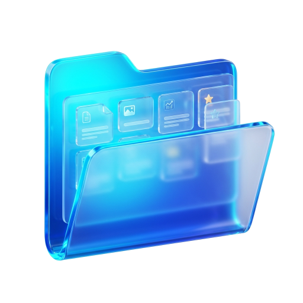
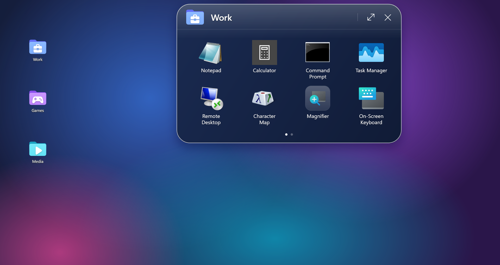
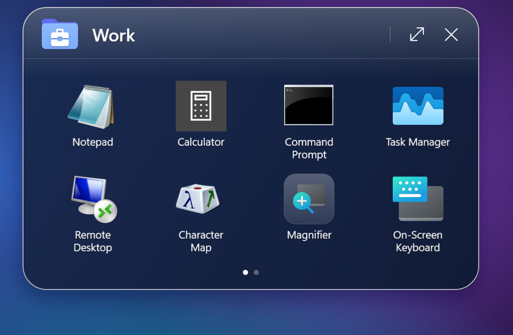
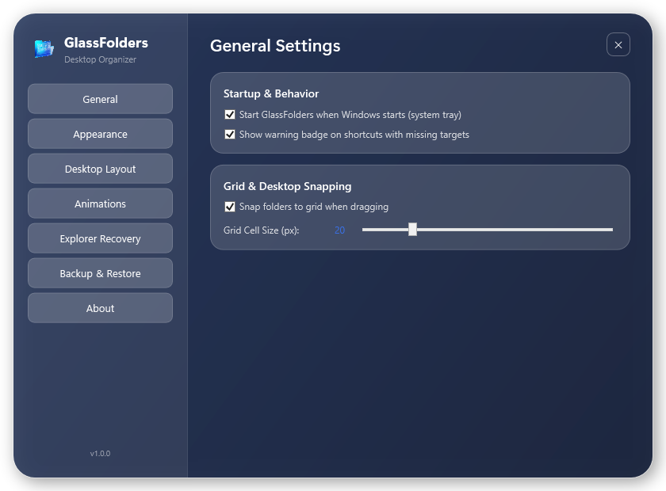
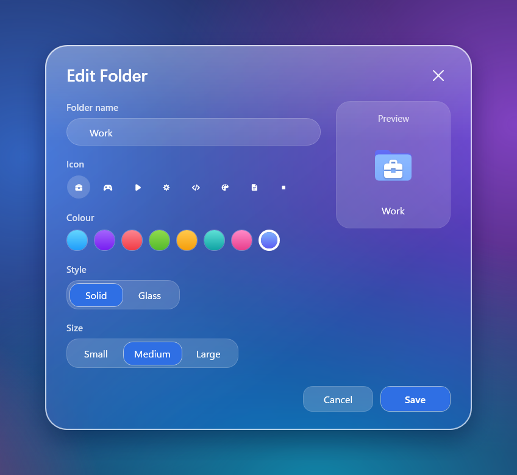
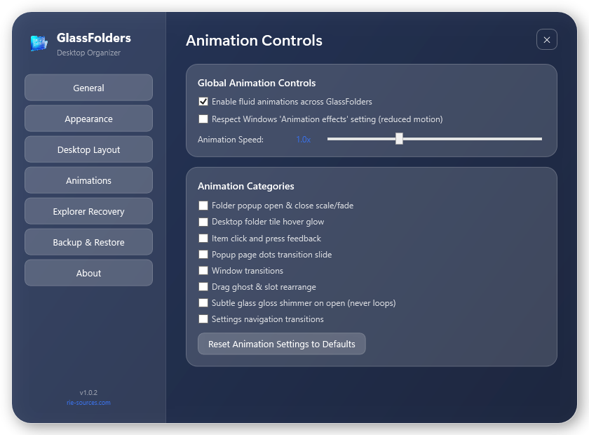
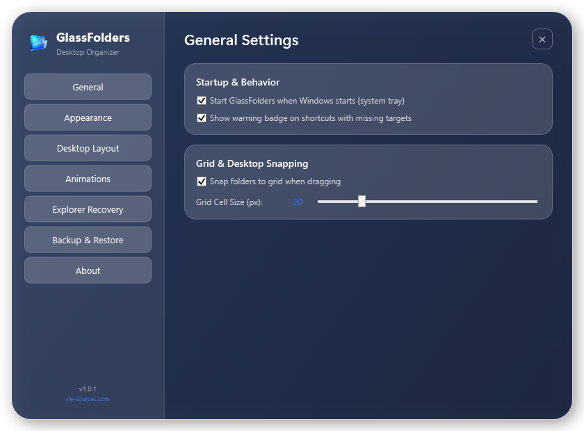

#  GlassFolders

Phone-style app folders on your real Windows 11 desktop, with a Liquid Glass popup.  
Created & maintained by **[Rie-Sources](https://rie-sources.com/)**.

> **Status: `v1.1.2`.** Built for Windows 11 (tested on 25H2). 239/239 automated tests pass, Explorer recovery is event-driven, and there are no runtime dependencies beyond .NET 10. See [docs/VISUAL-PARITY-PLAN.md](docs/VISUAL-PARITY-PLAN.md) for how the look was matched to the design target and [docs/KNOWN-ISSUES.md](docs/KNOWN-ISSUES.md) for what hasn't been tested.



---

## Screenshots

> These are real captures of the running app. `tools/ScreenshotCapture` fills the screen with a neutral wallpaper it draws itself (no personal or third-party picture), opens the real windows on it and reads the pixels back from the screen, so the glass is the real glass. The folders and items are Windows' own programs on a throw-away config. Nothing is drawn to imitate the app, and the taskbar is left out of the first image.

| Liquid Glass Folder Popup | Settings Dashboard |
|:---:|:---:|
|  |  |
| *Folder popup with app icons, pagination, and category glyph * | *Glass sidebar navigation with full personalization, layout, and recovery controls* |

| Folder Appearance Customization | Granular Animation Controls |
|:---:|:---:|
|  |  |
| *Real-time vector preview, dual-stop color gradients, and category glyph picker* | *8 independent category toggles, speed slider, and Windows reduced-motion sync* |

---

## Overview

**GlassFolders** brings the mobile home-screen folder experience to Windows 11 without hacky overlays or third-party bloat. Folders like *Work*, *Games*, *Media*, and *Utilities* sit directly on your desktop layer alongside standard icons. Clicking a folder opens a frosted glass panel displaying real application icons, shortcuts, and files.

- **Native Desktop Integration:** Each folder is a small, borderless Progman-owned window pinned below normal applications. Desktop rubber-band selection, desktop icons, and Win+D ("Show Desktop") continue to work seamlessly.
- **Liquid Glass Interface:** Frosted popup with smooth rounded corners, a tint that adapts to your wallpaper, light rims and customizable vector category glyphs. Settings, menus and dialogs use the same glass, with a light and a dark theme and Appearance sliders for transparency, blur, border, shadow and corners. Matched to the design target; see the parity plan for the details.
- **Automated Explorer Recovery:** Event-driven state machine (`Healthy → ShellLost → WaitingForShell → Reattaching → Verifying`) automatically recovers desktop surfaces with exponential backoff on Explorer crashes, taskbar recreation, session locks, and power resumes.
- **Multi-Monitor Layouts:** Position math uses work-area relative fractions and persistent monitor identities. When a secondary screen is unplugged, folders gracefully displace to the primary monitor and return to their home screen when reconnected.
- **Portable Backup & Restore:** Self-contained `.zip` backup format with SHA-256 manifests, automated rolling pre-restore backups (max 10), collision-free merge mode, and intelligent path relinking for cross-PC migration.
- **Desktop Folders:** solid coloured folders with white glyphs, or a Glass style, in three sizes, or with your own picture. New folders take free cells of the desktop icon grid, never an icon's spot, and a frosted plate made from your wallpaper lights up the open folder.
- **Large Popup:** A 4 × 2 grid of 256 px icons with page dots, an expand button, and configurable columns and rows. It grows out of the clicked folder.
- **Drag to Reorder:** Press and drag an icon inside a folder popup to move it. A highlight shows where it will land and the icons glide into their new places; the order is saved. You can also drag files in from Explorer or the desktop to add them. Reordering works within the page you are viewing.
- **Animation Controls:** Master toggle, Windows reduced-motion (`SPI_GETCLIENTAREAANIMATION`) compliance, speed slider (0.5×–2.0×), and 8 category switches. Folder tiles and the popup both animate.
- **Ultra-Lightweight & Zero-Polling:** 0.00% idle CPU overhead, no periodic timer wakeups, and automated working set memory trimming (~50–65 MB typical).
- **System Tray Integration:** Runs quietly in the notification area; no taskbar button.

> **Safety Guarantee:** Removing an item or deleting a folder from GlassFolders **never** deletes the original application or file from your computer.

---

## Technical Architecture

- **Runtime:** .NET 10 (LTS) WPF with Per-Monitor-V2 DPI awareness.
- **Platform:** Windows 11 (22H2, 23H2, 24H2, 25H2+) and Windows 10 64-bit.
- **Glass:** Each time a popup opens, the area behind it is captured once, blurred and painted into the card. The capture stays in memory until the popup closes and is never saved. There is no continuous screen capture.
- **Packaging:** Inno Setup per-user installer (`{localappdata}\Programs\GlassFolders`, no administrator privileges required) and standalone portable ZIP distribution.

---

## Building from Source

Requires Windows 11 and the **.NET 10 SDK**.

```powershell
# Clone the repository
git clone https://github.com/Riekie3/Folder-Organizer.git
cd "Folder-Organizer"

# Build solution in Release mode
dotnet build GlassFolders.sln --configuration Release -warnaserror

# Run the test suite (231 tests)
dotnet test GlassFolders.sln --configuration Release

# Launch GlassFolders
.\src\GlassFolders.App\bin\Release\net10.0-windows\GlassFolders.exe
```

---

## Documentation

- [User Guide](docs/USER-GUIDE.md) — Shortcut management, appearance customization, and settings.
- [Architecture Documentation](docs/ARCHITECTURE.md) — Window hierarchy, Progman ownership, and DWM composition details.
- [Backup & Restore Guide](docs/BACKUP-RESTORE.md) — Portable ZIP schema, zip safety, and path relinking.
- [Performance & Stability Report](docs/PERFORMANCE.md) — Benchmarks, working set metrics, and idle CPU analysis.
- [Known Issues & Quirks](docs/KNOWN-ISSUES.md) — Windows 11 25H2 desktop behavior and workarounds.
- [Changelog](CHANGELOG.md) — Complete milestone release history.
- [Development Log](DEVLOG.md) — Phase-by-phase implementation journal.

---

## Credits & Publisher

- **Publisher / Creator**: [Rie-Sources](https://rie-sources.com/)
- **Website**: [https://rie-sources.com/](https://rie-sources.com/)

<p align="center">
  
</p>

---

## License

GlassFolders is open-source software licensed under the [MIT License](LICENSE). Copyright © 2026 [Rie-Sources](https://rie-sources.com/).
