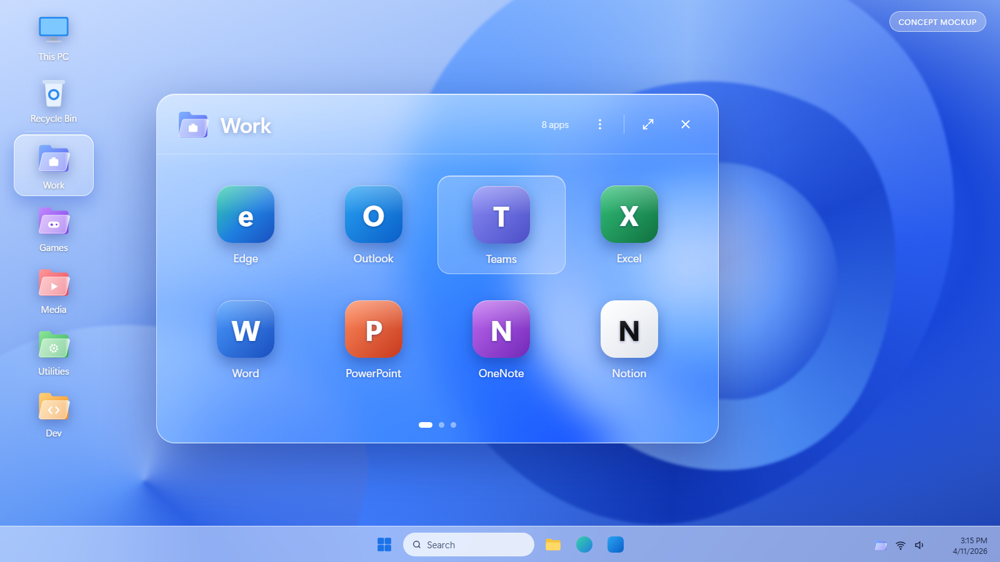

# GlassFolders

Phone-style app folders on your real Windows 11 desktop, with a Liquid Glass popup.

> **Status: planning.** No application code exists yet. The image below is a concept mockup, not a screenshot of working software.

## What it will do

GlassFolders brings the Android and iPhone home-screen folder experience to Windows. Folders such as Work, Games, Media and Utilities sit on the actual desktop next to your normal shortcuts. Click one and a translucent glass popup opens with your real apps, files and shortcuts inside.

- **Real desktop integration.** Folders sit on the desktop layer, behind normal windows. Your existing desktop icons keep working.
- **Explorer recovery.** Folders come back on their own after Explorer crashes or restarts.
- **Multi-monitor.** Each monitor keeps its own layout, matched by stable display identity rather than screen order.
- **Backup and restore.** Export everything to a portable ZIP and import it on another PC, with missing-app relinking.
- **Liquid Glass design.** Frosted glass, soft shadows, light and dark themes.
- **Animation controls.** A master switch, per-effect switches and three speeds. Everything works with animations off.
- **Lightweight.** Event-driven, no background polling, target under 100 MB of memory when idle.
- **Tray app.** Starts with Windows, lives in the notification area, no taskbar button.

Removing an item from a folder never deletes the original app or file.

## Tech

C# on .NET 10 with WPF, Win32 and Windows Shell APIs, DWM acrylic backdrop, JSON storage, Inno Setup installer. No runtime dependencies beyond .NET.

## Roadmap

| Phase | Goal | Version |
|---|---|---|
| 1 | Desktop integration proof of concept | v0.1.0-poc |
| 2 | Core desktop organizer | v0.2.0 |
| 3 | Liquid Glass interface | v0.3.0 |
| 4 | Tray, startup and Explorer recovery | v0.4.0 |
| 5 | Multi-monitor support | v0.5.0 |
| 6 | Portable backup and restore | v0.6.0 |
| 7 | Animation control system | v0.7.0 |
| 8 | Performance and stability | v0.9.0-rc |
| 9 | Installer and release | v1.0.0 |

Full details are in [PLAN.md](PLAN.md).

## Downloads

None yet. Stable installers will be published on the [Releases page](https://github.com/Riekie3/Folder-Organizer/releases).

## Repository layout

- `PLAN.md` – detailed development plan
- `docs/` – plan page and concept mockup source
- `Referance/` – visual reference images used for the design
