# GlassFolders – Visual parity plan

_Updated 2026-11-07. Goal: make the running app look as close as practical to `Referance/a226f8e2-….png`, then release as v1.1.0._

**Status:** Stages 0, 1, 2, 3, 4 and 5 merged to `main`. Stage 6 not started. **Nothing is tagged or released until every stage is finished and the look is approved.**

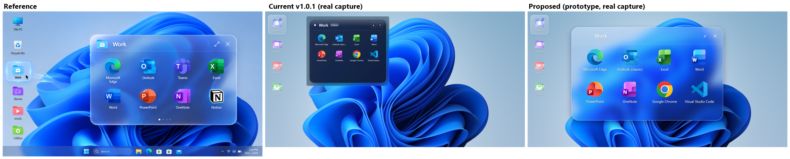

The middle and right images are real screen captures of WPF windows over the Windows bloom wallpaper. The wallpaper sat in a test window, so they aren't taken on the live desktop, and the right one is a prototype, not the app. The popup code hasn't changed since these captures.

---

## 1. What the latest update changed

One new commit, `2b1b0d0`: publisher branding only. Build is clean, 66/66 unit tests pass.

| Changed | Not changed |
|---|---|
| Publisher is now Rie-Sources in the installer, `LICENSE`, assembly metadata, README and User Guide | Popup, desktop folders, themes, native code: no lines changed |
| Settings: `rie-sources.com` link in the sidebar, publisher card on About | Other Settings pages, apart from the sidebar link and version text |
| Refreshed screenshots | How the screenshots are made |
| Tag `v1.0.1` moved to `2b1b0d0` | The installer attached to the release |

So every visual gap in this plan is still open. The branding stays: later stages keep the Rie-Sources credit and links.

---

## 2. Problems to fix first

| # | Problem | Evidence |
|---|---|---|
| 1 | **The download is an old build that has a known crash.** Release "v1.0.1" only offers `GlassFolders-Setup-v1.0.0.exe`, uploaded 19:48 UTC on Nov 6. The crash fix landed at 20:08, so it isn't in the installer. Neither are portable mode, the new icon or the branding. | Asset dates; installed exe reports `1.0.0+b4ab2cf`; Event Log shows two `AggressiveGC` crashes from the installed path on Nov 7 at 04:01 |
| 2 | **Moving the tag can't update the release.** Each move reruns packaging, which then fails. | Last 3 `Release Packaging` runs: "a release with the same tag name already exists" |
| 3 | **Windows startup launches the screenshot tool, not GlassFolders.** The entry now points at `…\tools\ScreenshotCapture\bin\Release\…\ScreenshotCapture.exe --tray`. Opening Settings from any exe rewrites it. | `HKCU\…\Run\GlassFolders`; `SettingsWindow.LoadSettingsToUi` sets the checkbox, which fires `OnStartupCheckChanged` |
| 4 | **That tool can change your real folders.** It ignores `--tray` and runs a full capture at each sign-in, using your real config. If a folder named Work, Games or Media has too few items, its code clears them and adds samples. | `Main()` takes no arguments; `new ConfigurationManager()`; `SetupWorkFolder` calls `Items.Clear()` |
| 5 | **The README's About image shows the General page.** | `settings-about.png` and `settings.png` are byte-identical |
| 6 | **The README gallery doesn't show real glass.** It is drawn off-screen with a fake desktop and taskbar, yet captioned "authentic". | `tools/ScreenshotCapture/Program.cs` |

---

## 3. Comparison with the references

### Reference 1: desktop and Work popup (main target)

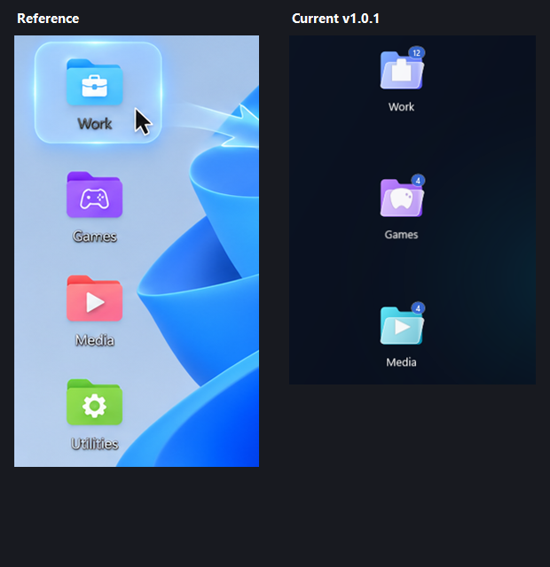

| Element | Reference | Current | Stage |
|---|---|---|---|
| Popup glass | Clear blur, wallpaper shapes visible | Near-opaque navy, `#E61A2B52` → `#E6101B36` | 1 |
| Behind the popup | Nothing | Square blur block around the rounded card | 1 |
| Popup scale | Large, 864 wide at this PC's scale | Half size, 440 wide | 2 |
| Popup position | About 350 DIP right of the folder | 12 DIP gap | 2 |
| Header | Colour folder, title, divider, expand, close | Small white glyph, count pill, close | 2 |
| Paging | Dots only | Arrows and dots | 2 |
| Open animation | Motion links folder to popup | None; `Animate.*` is only called from `FolderTile` | 2 |
| Folder icon | Solid coloured folder, crisp white glyph | Glass flap; briefcase and gamepad render as blobs | 3 |
| Selected folder | Large frosted plate with glow | Smaller, weaker plate | 3 |
| Count badge | None | Always on | 3 |
| Folder placement | In the desktop icon column | Fixed default on the right edge | 3 |

### Reference 2: 4×3 icon grid

Rounded tile behind each icon, and a lighter hover plate. Plan: use the 4×3 grid as the **expanded** view, use the hover plate everywhere, and use the tile only behind low-resolution app icons so they look intentional instead of blurry.

### Reference 3: glass panels

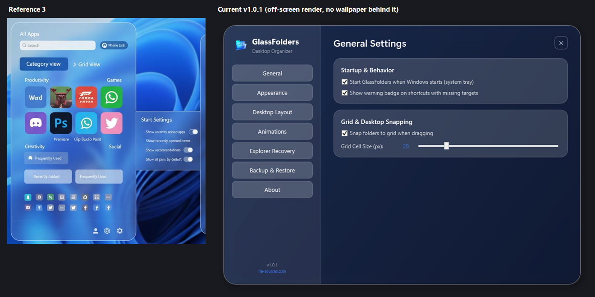

Pill inputs, blue selected state, white-knob toggles, soft buttons on light glass. Current Settings is a dark dashboard with stock checkboxes and sliders, and all nav buttons look alike. Plan: adopt the style for Settings, menus and dialogs. The launcher content in the picture (All Apps, Category view) isn't part of this app, so it isn't planned.

### Reference 4: glass folder

Blue-violet back with a frosted front flap and a soft glow. `PLAN.md` chose this as the default folder style, but reference 1 shows solid folders with white glyphs. The current icon mixes the two and matches neither. Plan: **reference 1 is the default, and reference 4 becomes a "Glass" folder style option.**

### Planned in `PLAN.md`, still missing

Checked by searching `src/`. "Not found" means no matching code, not a runtime test.

| Item | Status | Where |
|---|---|---|
| Popup open/close animation | `Shimmer` is never called; no popup animation | Stage 2 |
| Popup columns / rows settings | Saved only; the popup hard-codes 4×3 | Stage 2 |
| Expand button, popup resize | Not found | Stage 2 |
| 256 px icons (`IShellItemImageFactory`) | Not found; large icons are upscaled | Stage 2 |
| New folders placed in free desktop space | Not found | Stage 3 |
| Change Icon, folder sizes S/M/L | Not found; `FolderSize` is unused | Stage 3 |
| Light theme / Follow Windows | Not found | Stage 4 |
| Transparency, blur, border, corner, shadow, icon-size settings | Not found | Stage 4 |
| "Enable DWM Acrylic" checkbox | Not connected to any code | Stage 4 |
| Glass menus and rename dialog | No menu style; rename is a plain `ToolWindow`; 10 `MessageBox` calls | Stage 4 |
| Drag to reorder, keyboard grid navigation | Not found | v1.2 |
| EDID monitor identity, layout duplication, monitor mapping | Not found | v1.2 |
| Import preview, relink UI, per-folder Hide, startup delay | Core logic or model only | v1.2 |

The v1.2 items don't affect the look. Present as planned: desktop hosting, tray, backup export/import, recovery service, portable mode. The figures in `docs/PERFORMANCE.md` were not re-measured.

---

## 4. Glass techniques tested

Same content, same wallpaper. Results are from this PC (Win11 25H2, 125 %).

| Technique | Look | Corners | Verdict |
|---|---|---|---|
| Current (layered + documented Acrylic) | Navy card | Square block behind | Replace |
| Documented Acrylic, light / dark | Flat grey, shapes gone | Square | Rejected |
| Undocumented accent Acrylic, light tint | Washed out | Square | Rejected |
| Undocumented accent blur + blue tint | Very close | **Square; ignored `SetWindowRgn` and a DWM blur region** | Rejected unless corners are solved |
| **One-shot snapshot blur + tint** | **Very close** | **Smooth 40 px, soft shadow** | **Recommended** |

**Snapshot glass:** just before showing the popup, capture the screen area it will cover, shrink it, blur and saturate it, and paint it into the rounded card. It took 21 ms in a Debug build at 135×83 px, once per open, with nothing running afterwards.

Benefits: exact corners, a real Blur Intensity setting (the brief asks for one), and no undocumented APIs.

Trade-offs:
- The glass doesn't update while open, so a video behind the popup looks frozen. The popup is short-lived and closes on outside click.
- DRM-protected windows behind it may capture as black.
- It is a screen capture. It happens once per open, stays in memory and is never saved. The brief bans *continuous* capture.

---

## 5. Stages

Each stage ends with build + tests, a DEVLOG entry and a push. Model suggestions follow the original plan's reasoning.

### Stage 0 – Safe base · Small · Sonnet, medium
**Startup and capture tool**
- Write the Run key only when the user changes the toggle, only from the real app exe, and repair a wrong path on app start.
- Make `ScreenshotCapture` use isolated config and a relative output path. It must never touch real settings or folders.

**Release**
- Stop moving tags: each published build gets a new version number.
- Publish **v1.0.2** from current `main`, so the download no longer has the crash. Publish only after you confirm.
- Check the installer: its name and exe both report 1.0.2, it runs past the 5-second point, and the release page lists it as latest.

**Record**
- Read the version from assembly metadata. Settings hard-codes it in two places.
- Label the README gallery honestly until Stage 6 replaces it, and remove the wrong About image. Correct the Acrylic and animation claims.

**Done when:** after opening Settings from a test exe, the Run key and real config are unchanged; a clean install of the published v1.0.2 stays running.

**Result:** code merged. The release steps above are replaced by the publishing rule: no v1.0.2 release, and the first published build is v1.1.0.

### Stage 1 – Glass engine · Medium · Opus, high
- Add `BackdropSnapshot` (capture, downsample, blur, saturate; multi-monitor and DPI aware) with unit tests for the pure image maths, in optimized code.
- Add a reusable `GlassCard`: snapshot, tint, top gloss, 1.2 px light rim, soft shadow.
- Add adaptive tint so very dark or very bright wallpapers stay readable. This matters on your dark ROG wallpaper, where glass will look much darker than the reference unless tint compensates.
- Remove `EnableAcrylic` from layered windows, which removes the square block.
- Fall back to a solid tinted panel for high contrast, transparency off, and capture failure.

**Done when:** on bloom and on your wallpaper, corners are smooth and no square block is visible; capture + blur ≤ 30 ms in Release; idle CPU stays at 0.

**Result:**

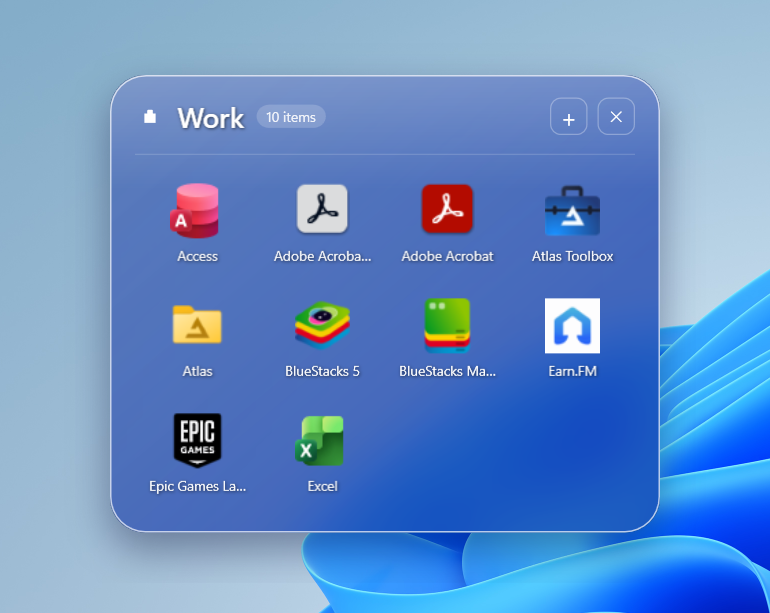

- Corners and square block: met, on both wallpapers.
- Time: 8–18 ms across 6 real opens. Repeated every 120 ms it was median 20 ms with spikes up to 58 ms, so 30 ms isn't guaranteed.
- CPU: nothing runs after the capture. 0–31 ms of CPU over 5 s with the popup open.
- Settings and the folder editor lost their DWM backdrop, and use a tinted panel until Stage 4.
- Not run on the live desktop yet: Stage 5.

### Stage 2 – Popup matches the reference · Large · Opus, high
- Apply the metrics in section 6, including the popup's position beside the folder.
- Header: full-colour folder icon, title, divider, expand ⤢, close ✕. Remove the count pill. Move + to right-click and a ⋯ menu; drop stays.
- Page dots only, no arrows. Mouse wheel and arrow keys change page.
- Default 4×2. Wire up the columns and rows settings; card height follows rows so there is no empty row.
- 256 px icons with correct alpha, decoded at display size, disk-cached. Low-resolution icons get the rounded tile from reference 2.
- Two-line labels ("Microsoft / Edge") and the hover plate from reference 2.
- Real open/close animation, growing from the clicked folder, through `Animate`, honouring the animation settings.
- Keep capture time in budget at the larger card: Stage 1 measured a median of 37 ms at this size. Options: sample every second pixel when shrinking, or reduce the overscan.
- Capture enough area for the expanded 4×3 card, since the popup can't capture itself once open. The glass slides rather than leaving a gap if the card outgrows the capture.
- Expand ⤢ switches to the 4×3 view. Popup stays clamped inside the work area.

**Done when:** overlaid on the reference at matching scale, panel edges, header line and icon centres are within about 4 % of the reference position.

**Result:**

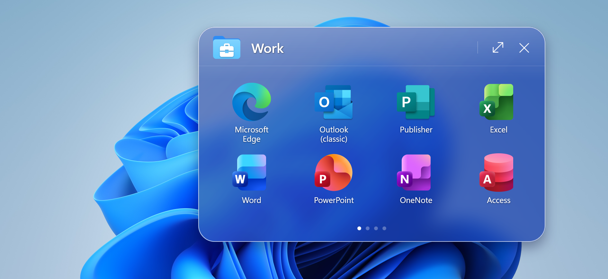

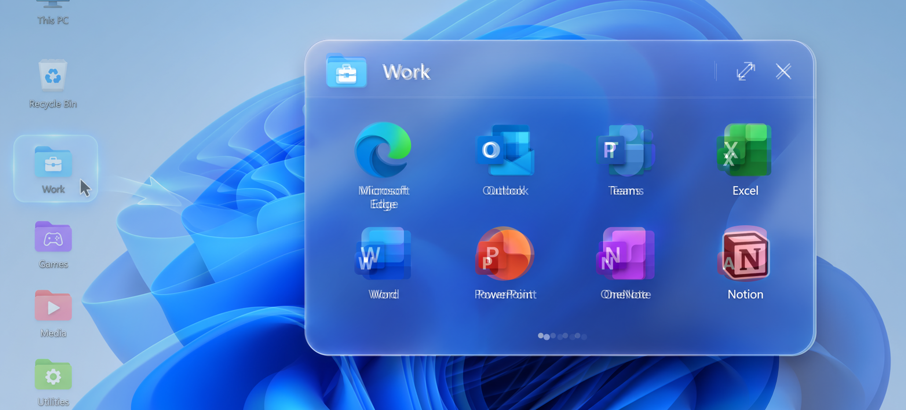

Measured at 1920×1080. Reference positions are scaled from its 1672 px image.

| Element | Reference | Popup | Off by |
|---|---|---|---|
| Card left, top | 648, 176 | 645, 174 | 3, 2 px |
| Card right, bottom | 1729, 845 | 1725, 844 | 4, 1 px |
| Header line | 299 | 297 | 2 px |
| Icon centres, across | 814, 1075, 1330, 1580 | 811, 1067, 1323, 1579 | 8 px at most |
| Icon centres, down | 408, 631 | 409, 629 | 2 px at most |
| Page dots, down | 805 | 803 | 2 px |

- Target met: the largest difference is 8 px, or 0.4 % of the screen width.
- Tested with real mouse and keyboard input over a test window: hover, wheel, page dots, arrow keys, expand, both menus, close button, Escape, clicks in the empty gap and on the shadow.
- Capture and frost, median of 30: 30 ms for up to one page of items, 36 ms for a folder that can expand. Spikes reach 41 ms. A bigger folder has to capture the expanded card, so the 30 ms target isn't met there.
- Popup open, from constructing it to `Show` returning: about 130 ms, range 44–175 ms. This is over the 100 ms warm target in `PLAN.md`, on a much larger window than that target assumed. Stage 5 re-measures it in the real app.
- Windows' animation effects setting is off on this PC, and the app follows it by default, so the open animation doesn't play here unless that changes. The test turned that setting off so the animation would run.
- Not run on the live desktop yet: Stage 5.

### Stage 3 – Desktop folders match · Medium · Opus, high
- Redraw the folder per reference 1: solid coloured folder with a crisp white glyph. Use Segoe Fluent Icons for consistent glyphs, with a fallback. Add the reference 4 style as a "Glass" option.
- Reference palette: blue, purple, coral, green.
- Frosted selected plate with soft glow; label contrast chosen from the wallpaper behind it. Item-count badge off by default, with a setting.
- Default placement: find free desktop grid cells through the shell's documented `IFolderView` API, aligned to the icon grid, starting under the left column as in the reference. Existing saved positions stay untouched.
- Add Change Icon and wire up folder sizes S/M/L.
- Add a simple 16 and 24 px app and tray icon. The current detailed icon doesn't read at small sizes.

**Done when:** a new folder never lands on an existing icon on your desktop, and the column reads like the reference's left side.

**Result:**

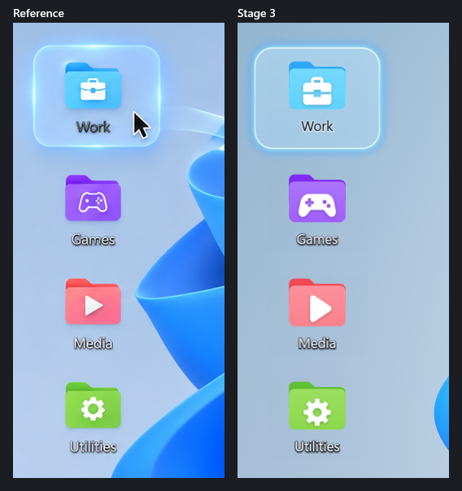

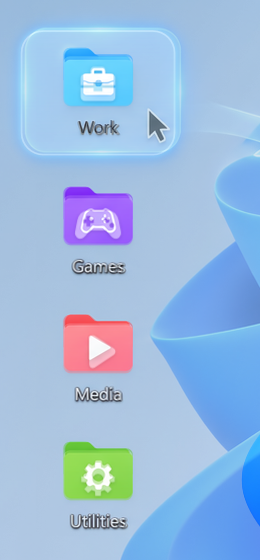

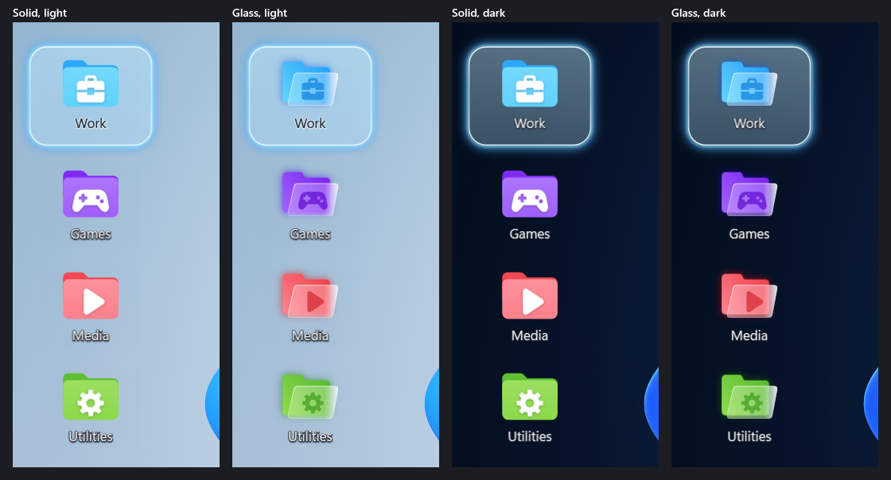

The images are the app's own `FolderTile`, rendered off-screen at the reference's scale (1672 px for this PC's 1536 DIP desktop), with each folder centred where the reference has it. The plate's glass uses the app's wallpaper code, reading the test wallpaper. Measured in reference pixels:

| Element | Reference | Stage 3 | Off by |
|---|---|---|---|
| Folder art | 69 × 58 | 70 × 59 | 1 px |
| Selected plate | 156 × 126 | 153 × 124 | 3 px |
| Label tops: Games, Media, Utilities | 561, 689, 817 | 559, 688, 815 | 2 px at most |
| Label widths | 52, 43, 54 | 49, 45, 55 | 3 px at most |

On this PC's desktop:
- The grid comes from Windows' own desktop view through `IFolderView`: 95 × 122 px cells at 125 %, read in about 30 ms.
- A dry run against the 65 icons there placed six test folders. All six landed in free cells and none touched an icon. The first five columns are full, so new folders start in column 6.
- A sandbox copy of the app, run on the live desktop, placed the four sample folders in column 6, rows 2–5. All four were attached to the desktop. It used 6.9 MB of working set after its memory trim, and exited cleanly.
- The wallpaper read for the plate takes about 190 ms for the first folder, which decodes the picture, then about 2 ms per folder.
- Saved positions are moved once so each folder keeps its centre in the larger window. Existing folders aren't placed again, so on this PC the three saved folders still sit at the old right-edge default, over icons, until they are dragged.

Changed from the plan above:
- Glyphs are the vector shapes from Stage 2, not Segoe Fluent Icons. The popup header, menus and editor share the same art, and nothing depends on a font.
- The plate is at most one grid cell plus 36 DIP wide, so on a tight grid it doesn't cover the neighbouring icons. On this PC's grid that is 112 DIP instead of the reference's 142. The comparison above uses a wider grid, which allows the full size.
- Labels are one line, with the full name in a tooltip. Two lines would need two grid rows per folder.
- Dragging snaps to the nearest free cell of the desktop grid. The old Grid Cell Size slider is gone.
- Hide, item 8 of the brief's folder menu, stays in v1.2, as section 3 planned.

Not tested on the live desktop: hovering and opening a folder with the real mouse, Change Icon with a picture, other display scales, a second monitor. Stage 5 covers these.

### Stage 4 – Settings, menus, dialogs · Medium · Sonnet, high (Opus if the moving-glass step fights back)
- Styles from reference 3: glass toggle, slider, pill input, segmented control, left-aligned sidebar with icons and a selected state.
- Build the missing Appearance settings and make them work live: Light / Dark / Follow Windows, transparency, blur, border, corners, shadow, icon sizes.
- Glass context menus, tray menu and rename dialog; replace the 10 `MessageBox` calls where it's user-facing.
- About page: keep the Rie-Sources card and links, replace the 🌐 emoji with a proper icon, and correct the architecture line.
- Settings moves on screen, so its glass needs handling: take a monitor-wide snapshot at open and shift it with the window. Fall back to the tinted panel if this looks wrong in testing.

**Done when:** no stock control is visible on any page, and every setting visibly changes something.

**Result:** built and tested off-screen and with a sandbox copy on the live desktop. Not yet tried with the real mouse (Stage 5).

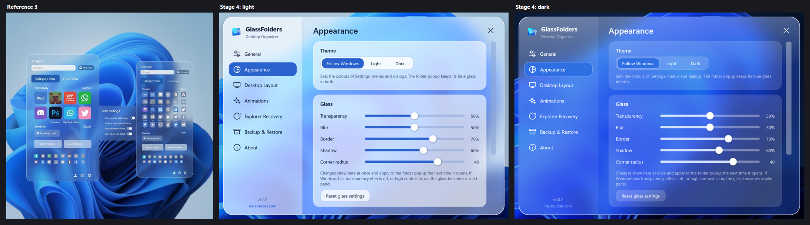

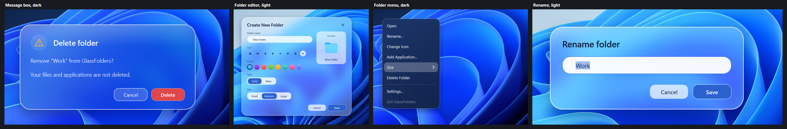

| Plan item | Result |
|---|---|
| Reference 3 styles | Toggle with white knob, glass slider, pill input, segmented control, sidebar with icons and a blue selected pill |
| Appearance settings, live | Theme, Transparency, Blur, Border, Shadow, Corner radius, icon size, columns and rows. "Enable DWM Acrylic" removed (it was never connected) |
| Glass menus, tray menu, rename, message boxes | All menus use one style. The 10 `MessageBox` calls and the rename window are glass dialogs |
| About | Drawn globe icon; architecture line corrected; Rie-Sources card and links kept |
| Moving glass | Monitor-wide snapshot at open, shifted as the window moves, as planned. Solid panel off its monitor |
| Log level (found in Stage 3) and missing-target badge | Both were saved but never read; now connected |

Changed from the plan above:
- The popup keeps its blue glass in light mode, as in the reference. Theme changes Settings, menus and dialogs.
- Menus and tooltips can't carry a snapshot, so they are nearly opaque rather than frosted.
- Not planned: the Blur slider re-filters a half-size copy kept in memory while Settings is open, so it can change without capturing the screen with the window in the way.

Not tested on the live desktop: the controls with the real mouse, the Windows light/dark switch while running, a second monitor, other scales, high contrast. Stage 5 covers these.

### Stage 5 – Real-world check · Small · Sonnet, high
Test on the live desktop: 4 wallpapers (bright bloom, your ROG, busy photo, solid), 100/125/150 % scaling, light and dark mode, transparency off, high contrast, popup over an app window and near every screen edge, popup open while a video plays behind it. Re-measure idle CPU, memory and open time.

**Result:** run on the live desktop with a sandbox copy and the real mouse, with the user switching Windows settings. Details and numbers are in `DEVLOG.md`.

| Plan item | Result |
|---|---|
| Hover, open, menus, rename, Change Icon glyph, drag and snap, Settings controls | Work with the real mouse |
| Light and dark mode | Settings, menus and dialogs follow Windows while running |
| 100 / 125 / 150 % scaling | **Found a bug**: folders stacked on each other and on icons after a change. Fixed and re-tested at 150, 100 and 125 % |
| Transparency effects off, high contrast | Solid panels, readable. An already open window kept its glass; fixed |
| Popup near screen edges | Top-left and bottom-centre checked; right edge not (another window covered it) |
| Popup over an app window | Over Settings, which is an app window; not over a third-party app |
| Four wallpapers | The user's current wallpaper live; two Windows wallpapers off-screen in Stage 4. Not four |
| Video behind the popup | Not tried; the glass is a snapshot and doesn't change while the popup is open |
| Second monitor, Settings across monitors | Not tried: one screen |
| Idle CPU, memory, open time | 0.000 %; 8–14 MB working set, 55–110 MB private; popup 28–135 ms warm (median about 60). Private memory is over the 60 MB target after use, flat, no leak |

Also fixed: a folder minimised by another tool shows again at once.

Not covered, and left for the user's own eyes in Stage 6: the right-edge popup, a second monitor, the other wallpapers, Choose Picture with a real file.

### Stage 6 – Proof, docs, release · Small · Sonnet, medium
- Replace `ScreenshotCapture` with real on-screen captures on a neutral wallpaper. Personal desktop images stay out of the public repo.
- Replace the README gallery; correct `ARCHITECTURE`, `PERFORMANCE`, `USER-GUIDE`, `KNOWN-ISSUES`, `DEVLOG`.
- Build and test the installer; release **v1.1.0** after you approve the look.

---

## 6. Target metrics

Measured by eye from the reference (1672 px wide) and scaled to this PC's 1536 DIP desktop. Treat as starting values and tune against the overlay.

| Element | Current | Target |
|---|---|---|
| Popup size | 440 wide, min 310 tall | **864 × 536**, tall view 864 × 712 |
| Corner radius | 28 | **40** |
| Glass tint opacity | ~90 % navy | **~20–30 % blue/white gradient over blur** |
| Gap from folder to popup | 12 | **~350, reduced when there's no room** |
| Header height | ~50 | **~98** |
| Title | 22 | **33.5 semibold** |
| Header icon | 24 white glyph | **~64 full-colour folder** |
| App icon | 44 | **96** |
| Item label | 11 | **20** |
| Grid | 4×3 | **4×2, expanded 4×3** |
| Cell pitch | 100 × 92 | **205 × 176** |
| Desktop folder icon | 60 | **64** |
| Folder label | 13 | **15–17** |
| Folder column spacing | ~144 | **~117** |
| Selected plate | 104×112, radius 16 | **~142×115, radius 20** |

At this size the popup covers about 56 % of your screen width, as in the reference. It is the default unless you choose otherwise, and it stays clamped to the work area on smaller screens.

---

## 7. What won't match exactly

- The reference is concept art on a bright wallpaper. On a dark wallpaper the glass will be darker; adaptive tint keeps it readable, not identical.
- Icons are your apps' own. Their shapes and shine differ from the picture.
- The swoosh between the folder and popup in the reference is not planned as a permanent element. The open animation provides that connection.
- Your taskbar and system icons stay Windows' own.

---

## 8. Decisions

1. **Glass technique:** snapshot glass. Decided by starting Stage 1 on the recommended option; tell me if you'd rather have live blur with square corners.
2. **Default popup size:** reference size (recommended), or smaller.
3. **Folder style:** reference 1 solid by default with reference 4 as an option (recommended), or reference 4 by default as `PLAN.md` first chose.
4. **Where work happens:** the latest update was made from `D:\Rie\Antigravity\Folder Organizer`, while this plan was written from `D:\Rie\Claude\Folder Organizer`. Both match `main` now. Use one copy only, and pause other edits while a stage runs, to avoid conflicting changes.
